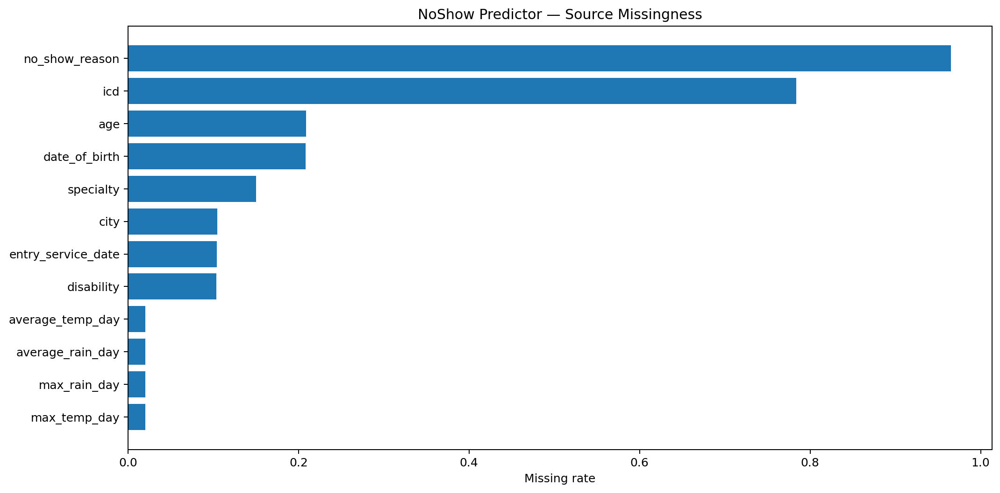
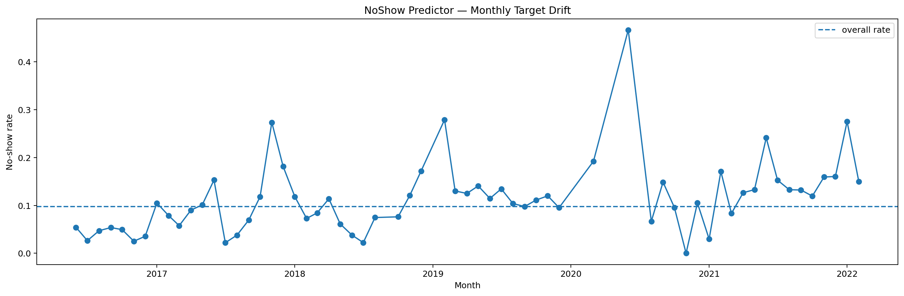
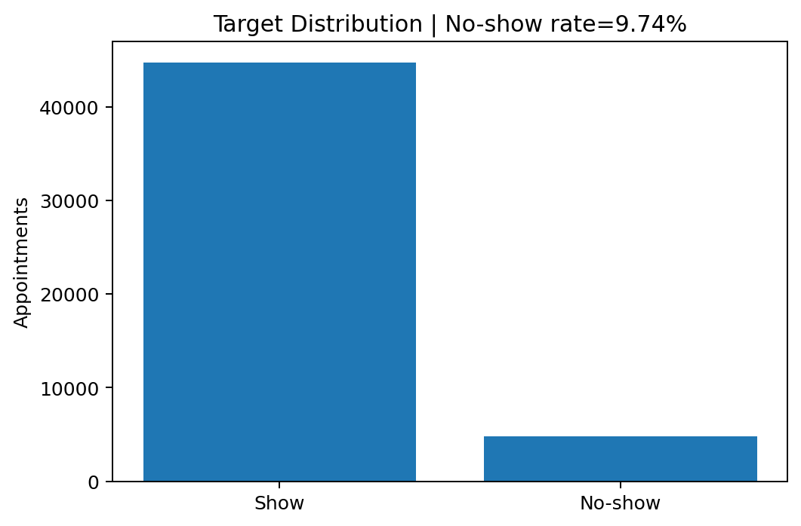
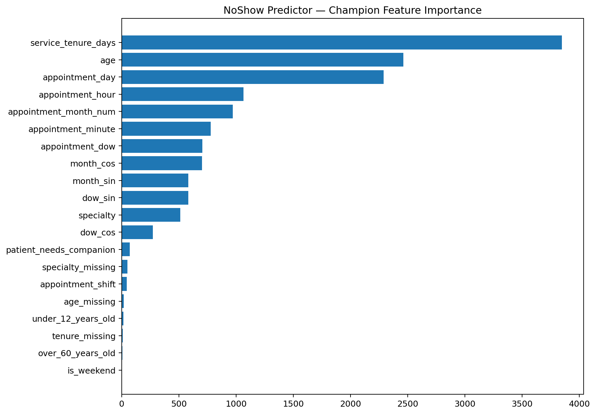
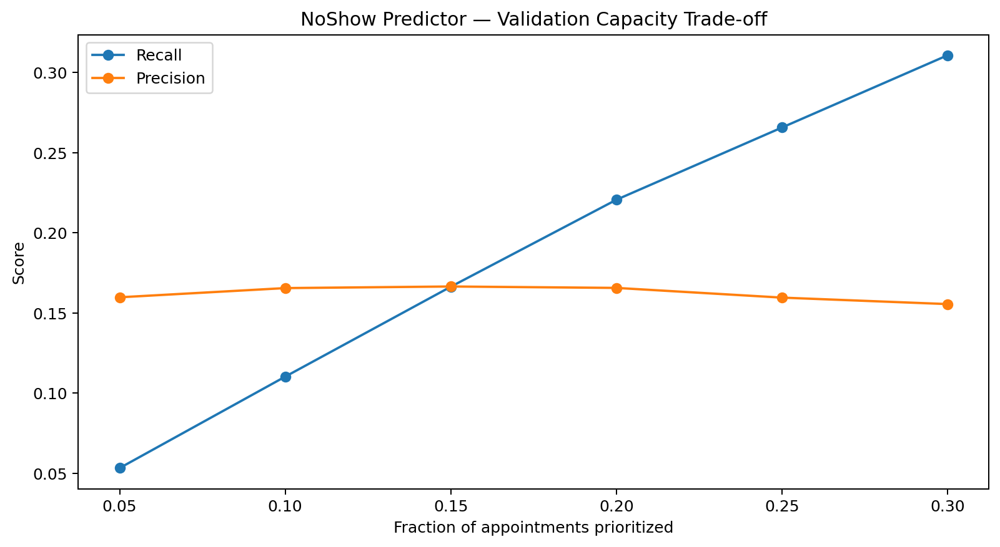
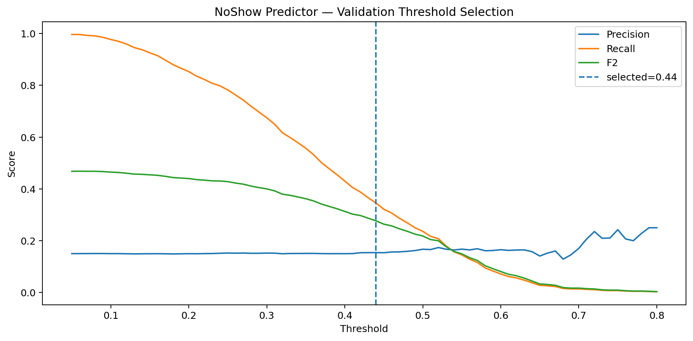
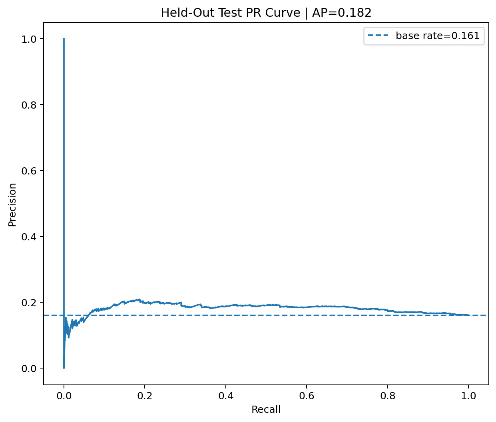
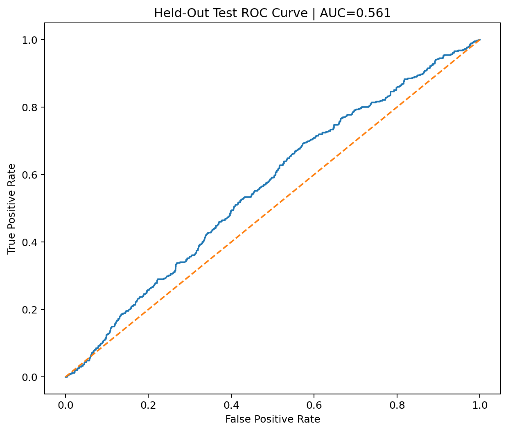
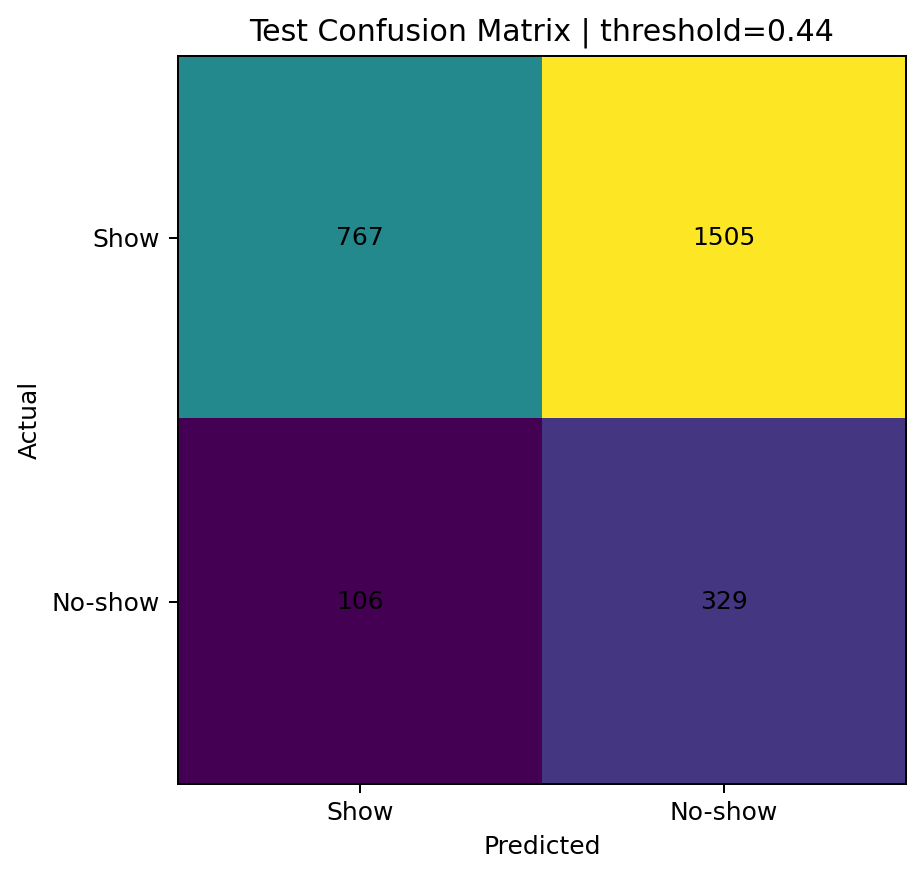

# NoShow Predictor

> **Portfolio milestone: 14%**  
> A pre-appointment no-show risk prioritization MVP for reminder operations.

[](#requirements)
[](#model-selection)
[](#streamlit-application)
[](#testing)
[](LICENSE)

## Overview

NoShow Predictor is a portfolio-grade machine-learning MVP that ranks upcoming appointments by estimated no-show risk so scheduling or service-operations staff can prioritize reminder outreach when reminder capacity is limited.

The project is intentionally framed as **risk prioritization**, not as a system that decides whether a patient will or will not attend. The operational output is a ranked list, usually consumed as a **Top-K / Top-X% reminder queue**, with a human reviewer remaining in control.

The project covers the full workflow:

- source-data audit;
- leakage and sensitive-feature policy;
- feature engineering using pre-appointment information only;
- strict temporal train/validation/test evaluation;
- baseline and model comparison;
- validation-only threshold selection;
- capacity-aware evaluation;
- subgroup and failure analysis;
- reproducible report artifacts;
- Streamlit inference UI;
- local deployment fallback using a pure-Python LightGBM tree evaluator.

## Problem

When appointment volume is high, service teams may not have enough capacity to contact every appointment with the same intensity.

The product question is:

> Given information available **before an appointment occurs**, which appointments should be prioritized for reminder outreach?

The intended workflow is:

```text
upcoming appointments
        ↓
input validation
        ↓
pre-appointment feature engineering
        ↓
champion model risk score
        ↓
descending ranking
        ↓
Top-K / Top-X% reminder capacity
        ↓
human review
```

## Claim Boundaries

### Supported claims

This repository supports claims about:

- pre-appointment no-show **risk ranking**;
- temporal held-out evaluation;
- validation-selected model comparison;
- reminder-prioritization lists;
- Top-10%-capacity precision, recall, and lift;
- a historical validation threshold retained for experiment traceability.

### Unsupported claims

This repository does **not** support claims about:

- diagnosis;
- clinical urgency;
- treatment outcome;
- patient blame;
- punitive decisions;
- automatic appointment cancellation;
- universal no-show probability across hospitals, salons, studios, or other businesses;
- guaranteed probability calibration outside the source distribution.

**Risk score ≠ certainty of no-show.**

## Dataset

The notebook uses **Medical Appointments No-Show**.

Canonical notebook path:

```text
/kaggle/input/datasets/wafabila/medical-appointments-no-show/Medical Appointments No-Show/medical-appointments-no-show-en.csv
```

### Source audit

| Item | Value |
|---|---:|
| Rows | 49,593 |
| Source columns | 26 |
| Date range | 2016-06-20 → 2022-02-25 |
| Unique appointment dates | 1,001 |
| No-show rows | 4,832 |
| Show rows | 44,761 |
| Overall no-show rate | 9.7433% |
| Exact full-row duplicates | 2,921 |
| Missing cells | 134,394 |

### Duplicate policy

The source contains exact duplicate rows, but they are **not automatically deleted**.

The dataset does not expose a stable patient identifier or appointment identifier. Two rows that are identical across the available fields may still represent distinct real appointments. Blind deduplication could therefore remove valid observations.

The duplicate count is documented as a limitation instead of silently “cleaning” the data.

## Data Quality Audit

The project explicitly audits missingness and temporal drift.

Major missingness observed in the source:

| Feature | Missing rate |
|---|---:|
| `no_show_reason` | 96.50% |
| `icd` | 78.39% |
| `age` | 20.87% |
| `date_of_birth` | 20.81% |
| `specialty` | 15.03% |
| `city` | 10.45% |
| `entry_service_date` | 10.39% |
| `disability` | 10.36% |

The target rate also changes over time, which is one reason this project uses a temporal split instead of a random split.

## Leakage and Feature Policy

The champion intentionally uses a narrower feature set instead of maximizing benchmark score with questionable information.

| Feature / group | Decision | Reason |
|---|---|---|
| `no_show_reason` | Exclude | Post-outcome information; direct leakage risk |
| `icd` | Exclude | Sensitive diagnosis proxy |
| `gender` | Audit only | Sensitive demographic |
| `city` | Exclude | Location/privacy proxy; weak portability |
| `disability` | Audit only | Sensitive attribute |
| `date_of_birth` | Exclude raw | Raw personal date; use age instead |
| Same-day observed weather | Exclude | May not be available at reminder time |
| Appointment date/time | Use derived | Known scheduling information |
| `specialty` | Use | Known service type |
| `age` | Use | Pre-appointment field |
| `entry_service_date` | Use derived | Used to derive service tenure |

A strong leakage indicator is `no_show_reason`: it is almost absent for show rows but materially more populated for no-show rows. It is therefore never used as a model feature.

## Feature Engineering

The champion model uses 20 features.

### Numeric features

- `age`
- `under_12_years_old`
- `over_60_years_old`
- `patient_needs_companion`
- `appointment_hour`
- `appointment_minute`
- `appointment_dow`
- `appointment_day`
- `appointment_month_num`
- `is_weekend`
- `dow_sin`
- `dow_cos`
- `month_sin`
- `month_cos`
- `service_tenure_days`
- `specialty_missing`
- `age_missing`
- `tenure_missing`

### Categorical features

- `specialty`
- `appointment_shift`

The local inference code reproduces the notebook's derived time, calendar, missingness, and tenure features.

## Evaluation Protocol

A random split would mix older and future appointments. Because the intended use is forward-looking, this project uses a **strict temporal split**.

| Split | Rows | Observed date range | No-show rate |
|---|---:|---|---:|
| Train | 39,643 | 2016-06-20 → 2020-12-16 | 8.3470% |
| Validation | 7,243 | 2021-01-27 → 2021-09-24 | 15.0214% |
| Test | 2,707 | 2021-10-05 → 2022-02-25 | 16.0694% |

Configured boundaries:

```text
Train:      <= 2020-12-31
Validation: 2021-01-01 → 2021-09-30
Test:       2021-10-01 → 2022-02-25
```

The gaps between configured boundaries and observed dates simply reflect dates for which the source contains no rows.

### Selection discipline

- Model family/champion: selected using **validation PR-AUC**.
- Threshold: selected using **validation only**.
- Test: used once after model and threshold decisions were locked.
- Held-out test performance does **not** retroactively replace the champion.

## Model Selection

Models compared:

- Logistic Regression — balanced;
- LightGBM — balanced;
- LightGBM — `scale_pos_weight`;
- LightGBM — unweighted.

### Validation results

| Model | PR-AUC | ROC-AUC | Brier | Precision @ 0.5 | Recall @ 0.5 | F1 |
|---|---:|---:|---:|---:|---:|---:|
| **LGBM-Balanced** | **0.1561** | 0.5065 | 0.1987 | 0.1670 | 0.2362 | 0.1957 |
| LGBM-Unweighted | 0.1545 | **0.5173** | **0.1342** | 0.1667 | 0.0009 | 0.0018 |
| LGBM-ScalePos | 0.1534 | 0.5009 | 0.1982 | 0.1469 | 0.2040 | 0.1708 |
| Logistic-Balanced | 0.1503 | 0.4982 | 0.2636 | 0.1466 | 0.5294 | 0.2297 |

**Champion:** `LGBM-Balanced`

**Selection metric:** validation PR-AUC.

The validation advantage is small. That is important: the project does not present the champion as a strong universal predictor.

## Threshold Selection

A threshold sweep from `0.05` to `0.80` was performed on validation predictions.

The experiment selected:

```text
historical validation threshold = 0.44
```

The search favored F2/recall while constraining the validation predicted-positive rate to at most 35%.

### Important operational caveat

After champion selection, the model was refit on Train + Validation. Refit changed the score distribution.

On the held-out test set, threshold `0.44` flagged **67.75%** of appointments. For that reason the Streamlit app does **not** use 0.44 as its default operational decision rule.

The main app view is capacity-based ranking instead.

## Official Held-Out Test

Champion: **LGBM-Balanced**

| Metric | Value |
|---|---:|
| PR-AUC | **0.1819** |
| ROC-AUC | **0.5609** |
| Brier score | 0.2523 |
| Precision @ 0.44 | 17.94% |
| Recall @ 0.44 | 75.63% |
| F1 @ 0.44 | 0.2900 |
| F2 @ 0.44 | 0.4603 |
| Predicted-positive rate @ 0.44 | 67.75% |
| Test rows | 2,707 |

### Top-10% capacity

| Metric | Value |
|---|---:|
| Appointments prioritized | 271 |
| Captured no-shows | 49 |
| Precision@10% | 18.08% |
| Recall@10% | 11.26% |
| Lift vs random | **1.125×** |
| Test base rate | 16.07% |

### Interpretation

The held-out result shows a **modest ranking signal**.

The system is therefore positioned as:

> a reminder-prioritization aid under constrained outreach capacity,

not:

> an accurate or definitive classifier of who will miss an appointment.

## Visual Evidence

The repository intentionally keeps generated plots in `assets/` so the README can show the actual experiment evidence.

### Dataset audit

#### Missingness



#### Monthly no-show drift



#### Target distribution



### Training and validation

#### Feature importance



#### Validation capacity trade-off



#### Validation threshold search



### Held-out evaluation

#### PR curve



#### ROC curve



#### Confusion matrix



> The current repository does not yet contain committed Streamlit screenshots. If screenshots are added later, place them under `assets/screenshots/` and render them here instead of only mentioning their paths.

## Streamlit Application

The application provides a practical reminder-prioritization workflow.

### Current features

- upload appointment CSV;
- validate required columns;
- inspect date range and row count;
- set reminder capacity from 5% to 50%;
- generate model scores;
- sort appointments from highest to lowest score;
- mark the Top-X% reminder-priority queue;
- inspect individual ranked appointments;
- show the historical threshold as an audit-only reference;
- show held-out context;
- save results locally;
- download the priority list as CSV.

### Required inference columns

```text
appointment_date
appointment_time
specialty
appointment_shift
age
under_12_years_old
over_60_years_old
patient_needs_companion
entry_service_date
```

The target (`no_show`) is intentionally not required for future inference.

### Run the app

```bash
streamlit run app/app.py
```

## Deployment Architecture

Training used the original LightGBM champion.

During local Windows deployment, native LightGBM prediction repeatedly produced an access-violation crash. Retraining a numerically encoded deployment variant made the runtime more portable but degraded ranking performance, so that retrained model was **not promoted as champion**.

Instead, the original 500-tree champion was exported to:

```text
models/noshow_champion_model.json
```

`src/inference.py` contains a pure-Python evaluator that traverses the exported LightGBM trees and applies the binary sigmoid objective.

Current local inference path:

```text
CSV
 ↓
src/preprocessing.py
 ↓
20-feature contract
 ↓
models/noshow_champion_model.json
 ↓
PurePythonLightGBM
 ↓
risk score
 ↓
capacity ranking
 ↓
Streamlit
```

### Model artifacts

```text
models/
├── noshow_champion.joblib
├── noshow_champion.txt
└── noshow_champion_model.json
```

- `.joblib`: original Python training artifact;
- `.txt`: native LightGBM text export;
- `.json`: original tree dump used by the current portable local runtime.

The repository keeps all three because they serve different reproducibility and deployment purposes.

## Repository Structure

```text
NoShow-Predictor/
├── app/
│   └── app.py
├── assets/
│   ├── dataset/
│   │   ├── missingness.png
│   │   ├── monthly_no_show_rate.png
│   │   └── target_distribution.png
│   ├── evaluation/
│   │   ├── test_confusion_matrix.png
│   │   ├── test_pr_curve.png
│   │   └── test_roc_curve.png
│   └── training/
│       ├── feature_importance_top20.png
│       ├── validation_capacity_tradeoff.png
│       └── validation_threshold_search.png
├── models/
│   ├── noshow_champion.joblib
│   ├── noshow_champion.txt
│   └── noshow_champion_model.json
├── notebooks/
│   └── noshow-predictor.ipynb
├── reports/
│   ├── false_negatives.csv
│   ├── false_positives.csv
│   ├── feature_importance.csv
│   ├── feature_policy.csv
│   ├── final_summary.json
│   ├── missingness_report.csv
│   ├── model_config.json
│   ├── model_selection.json
│   ├── monthly_target_drift.csv
│   ├── official_test_metrics.json
│   ├── operational_policy.json
│   ├── source_audit.json
│   ├── subgroup_age_audit.csv
│   ├── subgroup_disability_audit.csv
│   ├── subgroup_gender_audit.csv
│   ├── temporal_split_summary.csv
│   ├── test_predictions.csv
│   ├── test_risk_list.csv
│   ├── validation_capacity_analysis.csv
│   ├── validation_model_comparison.csv
│   └── validation_threshold_search.csv
├── src/
│   ├── __init__.py
│   ├── inference.py
│   ├── preprocessing.py
│   └── utils.py
├── tests/
│   ├── results/
│   └── test_inference.py
├── .gitignore
├── AGENTS.md
├── LICENSE
├── README.md
└── requirements.txt
```

## Installation

Recommended: Python 3.11.

```bash
git clone https://github.com/MENSTRUE/NoShow-Predictor.git
cd NoShow-Predictor

python -m venv .venv
```

Windows PowerShell:

```powershell
.venv\Scripts\Activate.ps1
```

Linux/macOS:

```bash
source .venv/bin/activate
```

Install:

```bash
python -m pip install --upgrade pip
python -m pip install -r requirements.txt
```

## Requirements

Current repository constraints:

```text
pandas>=2.2,<3.0
numpy>=1.26,<3.0
scikit-learn==1.6.1
lightgbm>=4.5,<5.0
joblib>=1.4,<2.0
streamlit>=1.40,<2.0
pytest>=8.0,<9.0
```

`scikit-learn==1.6.1` matches the version used when the original serialized estimator components were created.

The current Streamlit runtime uses the JSON tree evaluator for prediction, but the original dependencies remain valuable for reproducibility and notebook work.

## Testing

Run:

```bash
python -m pytest -q
```

The current suite covers:

- input validation;
- missing required columns;
- feature-contract ordering;
- calendar feature engineering;
- service-tenure handling;
- negative-tenure handling;
- categorical normalization;
- JSON model loading;
- 500-tree count;
- categorical metadata;
- unknown-category behavior;
- capacity prioritization;
- invalid-capacity rejection;
- historical threshold flags;
- end-to-end pure-Python inference.

A successful local run should complete without the previous native-LightGBM Windows access violation.

## Reproducibility

### Training

The canonical experiment is:

```text
notebooks/noshow-predictor.ipynb
```

The notebook writes experiment artifacts into `reports/`, `models/`, and `assets/`.

### Source-of-truth order

When values disagree, use this precedence:

1. `reports/final_summary.json`
2. specific machine-readable report for the metric in question;
3. the final notebook output;
4. README prose;
5. historical screenshots/posts.

### Random seed

The notebook uses:

```python
SEED = 42
```

### Reproducing the experiment

1. Obtain the original dataset.
2. Make it available at the documented Kaggle path or adjust `CSV_PATH`.
3. Run the notebook top-to-bottom.
4. Verify generated reports before changing README metrics.
5. Export model artifacts only from the final refit champion.
6. Re-run local tests after any inference change.

## Reports and Artifacts

Key reports:

- `source_audit.json` — dataset-level facts;
- `feature_policy.csv` — leakage/sensitive-feature decisions;
- `temporal_split_summary.csv` — observed split rows and rates;
- `validation_model_comparison.csv` — model selection evidence;
- `validation_threshold_search.csv` — threshold trade-off;
- `validation_capacity_analysis.csv` — capacity analysis;
- `official_test_metrics.json` — final held-out result;
- `test_predictions.csv` — row-level held-out predictions;
- `test_risk_list.csv` — ranked held-out list;
- subgroup audit CSVs — monitoring only;
- `false_negatives.csv` / `false_positives.csv` — failure analysis.

## Failure Modes

Known failure modes include:

- temporal drift in prevalence;
- weak ranking separation;
- high false-positive volume at the historical 0.44 threshold after refit;
- missing `age`, `specialty`, or service-entry date;
- unseen categorical values at inference;
- lack of patient history;
- identical rows that cannot be safely reconciled without IDs;
- out-of-domain use in a different service business.

The model should be revalidated whenever:

- reminder capacity changes materially;
- target prevalence changes;
- source workflow changes;
- new specialties appear;
- the product is moved to a new domain.

## Responsible Use

Recommended action:

- use scores to prioritize reminder outreach;
- keep a human reviewer in the loop;
- monitor false negatives and subgroup behavior;
- revalidate after distribution changes.

Do **not**:

- cancel appointments automatically;
- reduce clinical priority;
- reduce service access;
- penalize a person solely because of model score;
- treat the score as diagnosis or clinical risk.

## Before → Now → Next

### Before

The project began as a straightforward “predict no-show” classification idea.

That framing was too broad and encouraged an accuracy-first mindset.

### Now

The project is now framed as a **capacity-aware reminder prioritization MVP** with:

- strict temporal evaluation;
- explicit leakage policy;
- transparent weak/modest model performance;
- validation-only model selection;
- held-out capacity metrics;
- failure and subgroup audits;
- a Streamlit operational UI;
- a portable pure-Python deployment runtime preserving the original champion tree structure.

### Next

Highest-value improvements:

1. add booking-created timestamp and lead time;
2. add stable appointment and patient identifiers;
3. create safe attendance-history features;
4. record actual reminder-channel history;
5. calibrate/refit threshold using a dedicated calibration slice;
6. compare modern gradient boosting and calibrated baselines;
7. validate ranking utility prospectively;
8. monitor post-deployment drift;
9. add committed Streamlit screenshots;
10. test portability on Linux/cloud environments.

## Roadmap

### Data

- [x] source audit
- [x] missingness audit
- [x] temporal drift analysis
- [x] leakage policy
- [ ] stable identity features
- [ ] booking lead time
- [ ] reminder history
- [ ] prospective data collection

### Modeling

- [x] prevalence baseline
- [x] Logistic Regression
- [x] LightGBM candidates
- [x] validation selection
- [x] held-out test
- [x] capacity evaluation
- [ ] calibration study
- [ ] stronger ranking-specific objective
- [ ] repeated temporal backtesting

### Product

- [x] CSV upload
- [x] input validation
- [x] capacity slider
- [x] ranked priority list
- [x] appointment inspector
- [x] export result
- [ ] integrated reminder action
- [ ] feedback loop from staff
- [ ] monitoring dashboard

### Deployment

- [x] original champion artifact
- [x] native LightGBM export
- [x] JSON tree export
- [x] pure-Python local evaluator
- [ ] containerized deployment
- [ ] automated parity test against training runtime
- [ ] CI workflow

## Troubleshooting

### `Windows fatal exception: access violation`

Native LightGBM prediction previously crashed on the local Windows environment.

Current app inference should use:

```text
models/noshow_champion_model.json
```

through `PurePythonLightGBM`.

Do not switch the app back to native `Booster.predict()` merely because the `.txt` artifact exists.

### `JSON model not found`

Confirm:

```text
models/noshow_champion_model.json
```

exists and run commands from the repository root.

### Missing input columns

The app requires the nine documented raw input fields. It derives all remaining model features internally.

### Unknown specialty

Unknown categorical values are handled by the JSON evaluator as an unseen category. This is technically supported, but a large number of unseen categories indicates distribution shift and should trigger revalidation.

### Date parsing problems

Use day-first appointment dates such as:

```text
09/09/2021
```

### Streamlit launches from wrong folder

From repository root:

```bash
streamlit run app/app.py
```

## FAQ

### Is 0.44 the production decision threshold?

No. It is a historical threshold selected on validation predictions before the final refit. The app preserves it for auditability, while the primary operational view is capacity ranking.

### Why is PR-AUC low?

The available pre-appointment feature set carries only modest predictive signal, and the target distribution shifts over time. The project reports that limitation instead of hiding it.

### Why not include `no_show_reason`?

Because it is post-outcome information and would introduce direct leakage.

### Why not include ICD?

It is a sensitive diagnosis proxy and is outside the intended operational feature scope.

### Does Top-10% lift of 1.125× mean the model is strong?

No. It means the top-ranked 10% contained about 12.5% more no-shows than random selection at the same capacity on this held-out test. That is useful context, but still a modest signal.

### Can this model be used for salons or studios?

Not without revalidation. The current dataset comes from a medical-service context.

### Is the risk score a calibrated probability?

It should primarily be treated as a ranking score in this MVP. Calibration is not guaranteed out of domain.

### Why keep `.joblib`, `.txt`, and `.json`?

They preserve training reproducibility, native model export, and portable local inference respectively.

## License

The repository code is licensed under the [MIT License](LICENSE).

**Dataset rights are separate from the code license.** The MIT license in this repository does not grant rights to redistribute or relicense the source dataset. Follow the source dataset's own terms.

## Author

**Wafa Bila Syaefurokhman**  
Machine Learning / AI portfolio project.

Repository:

```text
https://github.com/MENSTRUE/NoShow-Predictor
```

---

If you use this repository as a learning reference, preserve the experiment boundaries: **ranking support, not clinical decision-making**.
